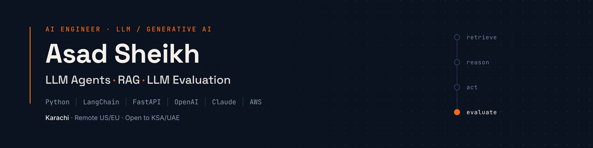

  

  
  
  
  

# Asad Sheikh — AI Engineer

**AI Engineer building production LLM applications, AI agents and the Python backends behind them.**
I own AI features end to end: system design, retrieval and agent architecture, evaluation, deployment and monitoring.

- 🧠 **Head of AI Development at 8ration (CoreCodez)** (joined as AI Developer Nov 2025, promoted Mar 2026): tool-calling AI records assistant, RAG chatbot, model-inference platform on AWS
- 💼 **Freelance AI Engineer on Upwork** (Mar 2024 – Nov 2025): Top Rated, 100% Job Success, 18 contracts (US, Europe, Middle East)
- 🛠️ **Building [SENTINEL](https://github.com/asadsheikh1/sentinel)**, an autonomous AI Site Reliability Engineer (in active development)
- 🌍 **Karachi, Pakistan (UTC+5)**: open to remote roles and to relocating to KSA / UAE

---

## Featured work

<table>
<tr>
<td width="50%" valign="top">
<a href="https://github.com/asadsheikh1/sentinel"><b>SENTINEL</b></a> · <i>in active development</i> 
AI SRE. <b>Built:</b> OpenTelemetry telemetry pipeline, auth/RBAC and the first detection layer (alert rule packs, signals, deploy and GitHub webhooks). <b>Planned:</b> LangGraph root-cause agents on local LLMs, pgvector memory, repair sandbox, published precision/recall. 
Python · FastAPI · PostgreSQL · OpenTelemetry · Prometheus · Loki · Jaeger · React · Podman
</td>
<td width="50%" valign="top">
<a href="https://github.com/asadsheikh1/aviro-shop"><b>AVIRO</b></a> 
Microservice demo shop with reproducible fault injection: the system SENTINEL monitors and is evaluated against. 
FastAPI · PostgreSQL · Celery · Valkey · Locust · OpenTelemetry
</td>
</tr>
<tr>
<td width="50%" valign="top">
<b>AI Records Assistant</b> · <i>case study, client code private</i> 
Natural-language → confirmed CRUD across 32 modules, permission-aware retrieval, human confirmation. 
Python · FastAPI · OpenAI · LangChain · FAISS · Azure AI Document Intelligence
</td>
<td width="50%" valign="top">
<b>Earlier ML projects</b> 
<a href="https://github.com/asadsheikh1/CodeAlpha">CodeAlpha</a>: spam classifier (NLP) and MNIST digit recognition ·
<a href="https://github.com/asadsheikh1/PythonKaggleRainInAustralia">Rain in Australia</a>: Kaggle classification study ·
<a href="https://github.com/asadsheikh1/PythonChatBot">PythonChatBot</a>: rule-based chatbot and NLP basics ·
<a href="https://github.com/asadsheikh1/BreastOnco">BreastOnco</a>: Flutter breast-cancer screening app
</td>
</tr>
</table>

## Tech stack

| Area | Tools |
|---|---|
| **LLMs & agents** | OpenAI · Anthropic Claude · Gemini · Qwen3 / Llama via Ollama & vLLM · LangChain · LlamaIndex · Pydantic AI · MCP · tool calling · structured outputs |
| **Retrieval** | Hybrid search (BM25 + dense) · cross-encoder reranking · pgvector · FAISS · Qdrant |
| **Evaluation & LLMOps** | Eval harnesses · LLM-as-judge · Langfuse · guardrails · prompt-injection testing |
| **Backend** | Python · FastAPI · asyncio · PostgreSQL · Supabase · Redis/Valkey · Celery · REST & WebSockets · OAuth2 · RBAC |
| **Cloud & observability** | AWS (EC2, ALB, ECS, Lambda, Bedrock, S3) · Azure AI Document Intelligence · Docker · Podman · Kubernetes · OpenTofu/Terraform · GitHub Actions · OpenTelemetry · Prometheus · Grafana · Loki · Jaeger |
| **ML** | scikit-learn · TensorFlow · LoRA/QLoRA fine-tuning (Hugging Face TRL, Unsloth) |

## How I build AI systems

- **Deterministic where it matters.** Rules and validation first; the LLM handles ambiguity, never unchecked writes.
- **Humans approve actions.** State-changing operations go through explicit confirmation and an audit trail.
- **Measured, not claimed.** Evaluation sets and regression tests before shipping a prompt or model change.
- **Results, not adjectives.** 10+ AI-powered apps deployed, 7M+ rows of hospital data structured (80% less manual processing), 30% faster ML APIs.
- **Observable by default.** Structured logs, metrics and traces from day one.

---

Older student, mobile and coursework projects are archived. Ask me about the Flutter/iOS apps I shipped before moving fully into AI engineering.
